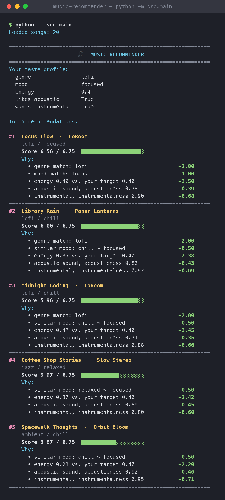

# 🎵 Music Recommender Simulation

## Project Summary

In this project you will build and explain a small music recommender system.

Your goal is to:

- Represent songs and a user "taste profile" as data
- Design a scoring rule that turns that data into recommendations
- Evaluate what your system gets right and wrong
- Reflect on how this mirrors real world AI recommenders

Replace this paragraph with your own summary of what your version does.

---

## How The System Works

This is a **content-based** recommender: it compares a user's stated preferences to each song's attributes. It does not use other users' listening behavior. (Real platforms like Spotify and YouTube combine this with *collaborative filtering*, which recommends what similar listeners played; this simulation has no listening history, so it uses song attributes only.)

### The plan

The program works in four steps. Each step has its own function, so the scoring rules can change without touching the ranking code.

```text
 data/songs.csv            user taste profile
       │                   (genre, mood, energy,
       ▼                    likes_acoustic, wants_instrumental)
 1. LOAD                          │
    load_songs()                  │
    CSV rows → dicts with         │
    numbers converted             │
       │                          │
       └────────────┬─────────────┘
                    ▼
 2. SCORE (one song at a time)
    score_song(user, song) → (score, reasons)
    applies the 5 rules in the Algorithm Recipe below
                    │
                    ▼
 3. RANK (the whole list)
    recommend_songs(user, songs, k)
    sort by score, highest first → keep top k
                    │
                    ▼
 4. EXPLAIN
    join the reasons from step 2 into a sentence:
    "genre match: lofi (+2.00); energy 0.35 vs. your target 0.40 (+2.38)"
                    │
                    ▼
          Top-k recommendations
```

**Why scoring and ranking are separate:** the scoring rule answers "how well does *this* song fit?" and can't see the other songs. The ranking rule answers "which songs should the user see, and in what order?", which needs the whole list (how many to show, how to break ties, and later list-level rules like diversity).

| Step | Function | File |
| --- | --- | --- |
| Load | `load_songs(csv_path)` | `src/recommender.py` |
| Score | `score_song(user_prefs, song)` | `src/recommender.py` |
| Rank + explain | `recommend_songs(user_prefs, songs, k)` | `src/recommender.py` |
| Same steps, object version | `Recommender.recommend()` / `explain_recommendation()` | `src/recommender.py` |
| Run with a profile | `main()` with the `STUDY_LISTENER` profile | `src/main.py` |

### Features used

- **Song:** `genre`, `mood`, `energy`, `acousticness`, `instrumentalness`
- **UserProfile:** `favorite_genre`, `favorite_mood`, `target_energy`, `likes_acoustic`, `wants_instrumental` (optional)

The user can be given either as a `UserProfile` object or as a plain dict (as in `src/main.py`). The dict uses shorter keys:

| Dict key | `UserProfile` field | Example (study listener) |
| --- | --- | --- |
| `genre` | `favorite_genre` | `"lofi"` |
| `mood` | `favorite_mood` | `"focused"` |
| `energy` | `target_energy` | `0.40` |
| `likes_acoustic` *(optional)* | `likes_acoustic` | `True` |
| `wants_instrumental` *(optional)* | `wants_instrumental` | `True` |

`tempo_bpm` and `danceability` are left out on purpose. In the original 10-song catalog they were highly correlated with `energy` (r = 0.96 and 0.86), and `acousticness` was almost its mirror image (r = −0.99). Scoring all of them would count "energy" several times and drown out genre and mood.

### The catalog

`data/songs.csv` has 20 songs across 17 genres and 16 moods. The original 10 were expanded with songs that fill gaps in the starter data: low-valence moods (melancholy, sad, angry) and songs that break the energy/acousticness link (e.g. a high-energy acoustic bluegrass track and a calm electronic downtempo track). This lowered the energy/acousticness correlation from −0.99 to −0.71.

Each song also has two extra columns:

- `instrumentalness` (0–1): how likely the track has no vocals. Used by the instrumental-fit rule when the user sets `wants_instrumental`.
- `popularity` (0–100): how mainstream the track is. Loaded but **not yet used in scoring**; useful for testing popularity bias.

`valence` (0–1) is also unused for now. It is the numeric feature least related to energy, which makes it a candidate for a later experiment.

### Algorithm Recipe

**Finalized recipe** (weights chosen in Experiment 3):

```text
score =  2.0  if genre matches exactly   (1.0 if partial, e.g. "pop" in "indie pop")
       + 1.0  if mood matches exactly    (0.5 if same mood group)
       + 2.5  × (1 − |song.energy − target_energy|)
       + 0.5  × acoustic fit             (acousticness, or 1 − acousticness)
       + 0.75 × instrumental fit         (only if the user set wants_instrumental)

maximum = 6.75   →   sort all songs by score   →   return the top k
```

Each rule in detail:

| Rule | Points | Why |
| --- | --- | --- |
| **Genre match** | +2.0 exact match (`pop` = `pop`); +1.0 partial match (`pop` inside `indie pop`) | Genre is the strongest taste signal, so it gets the most weight |
| **Mood match** | +1.0 if the moods are the same; +0.5 if they are in the same mood group (see below) | Links songs across genres (e.g. lofi/chill and ambient/chill) |
| **Energy closeness** | +2.5 × (1 − \|song energy − target energy\|) | Rewards songs *close* to the target, not just "higher" or "lower"; partial credit for near misses. Weighted so a big energy mismatch can outweigh a genre match |
| **Acoustic fit** | +0.5 × acousticness if `likes_acoustic`, otherwise +0.5 × (1 − acousticness) | Small tie-breaker for acoustic vs. produced sound |
| **Instrumental fit** *(optional)* | +0.75 × instrumentalness if `wants_instrumental` is true, +0.75 × (1 − instrumentalness) if false; skipped if not set | Separates vocal from instrumental songs, which energy and mood can't do |

**Mood groups** (partial credit for similar moods):

| Group | Moods |
| --- | --- |
| calm | chill, relaxed, focused, dreamy, romantic |
| upbeat | happy, uplifting, euphoric |
| intense | intense, angry, energetic, confident |
| melancholy | sad, melancholy, moody, nostalgic |

**Worked example:** the study listener (`lofi`, `focused`, energy 0.40, likes acoustic, wants instrumental) compared with two songs:

| Rule | *Library Rain* (lofi, chill, energy 0.35) | *Storm Runner* (rock, intense, energy 0.91) |
| --- | --- | --- |
| Genre | lofi = lofi → **2.00** | no match → 0 |
| Mood | chill and focused are both "calm" → **0.50** | intense is not calm → 0 |
| Energy | 2.5 × (1 − 0.05) → **2.375** | 2.5 × (1 − 0.51) → **1.225** |
| Acoustic | 0.5 × 0.86 → **0.43** | 0.5 × 0.10 → **0.05** |
| Instrumental | 0.75 × 0.92 → **0.69** | 0.75 × 0.10 → **0.075** |
| **Total** | **6.00** (ranked #2) | **1.35** (near the bottom) |

### Choosing recommendations

1. Score every song in the catalog with the recipe above.
2. Sort by score, highest first (ties keep catalog order).
3. Return the top `k` songs, each with an explanation listing every rule that awarded points and how many it added (e.g. "genre match: pop (+2.00); mood match: happy (+1.00); energy 0.82 vs. your target 0.80 (+2.45)"). The points add up to the score, give or take 0.01 from rounding.

### Expected trade-offs

- Genre (2.0) outweighs mood (1.0), so a same-genre song with the wrong mood usually beats a different-genre song with the right mood.
- Because genre matching is all-or-nothing, a user whose favorite genre isn't in the catalog gets ranked mostly on energy and acousticness. With 17 genres this is rarer, but a genre with only one song still gives that user one strong match followed by filler.
- **Genre wins small energy gaps; energy wins big ones.** Genre is worth 2.0 and energy closeness can differ by up to 2.5 between songs, so a same-genre song loses to a different-genre song only when its energy is about 0.8 further from the target (less when the other song also matches mood). A `pop` + chill + low-energy user now gets calm songs first, with one pop song still in the top 3.
- Energy can only help when the catalog has a song at that energy. The study listener with `energy` changed to 0.9 still gets the three lofi songs, because there is no upbeat lofi song and the acoustic/instrumental rules also favor calm tracks.
- Mood groups are hand-made. Putting "romantic" in the calm group lifts the vocal r&b song *Velvet Hours* for a focused listener, which a study listener probably wouldn't want.

### Potential biases

- **Over-prioritizing genre.** A genre match (2.0) is worth twice a mood match (1.0), so the system can ignore great songs that fit the user's mood. A rock fan who wants something chill gets the intense *Storm Runner* first, ahead of calm songs that match their mood exactly.
- **Uneven catalog coverage.** Lofi has 3 songs and pop has 2, but 15 genres have only one. Lofi fans get a full list of genre matches; a metal or folk fan gets one match followed by filler. The system quietly serves some tastes better than others because of what's in the data, not because of the algorithm.
- **Literal labels.** Genre matching compares text, so "hip hop" vs. "rap" or "lofi" vs. "lo-fi" would count as different genres. The partial-match rule also helps some genres more than others: "pop" fans get credit for "indie pop", but no other genre in the catalog has a related sub-genre.
- **The designer's assumptions are built in.** The mood groups, the weights, and the 10 added songs' feature values were chosen by hand, not measured from real listeners. Another designer could reasonably group moods differently and get different recommendations.
- **Calm music is favored for acoustic and instrumental listeners.** In this catalog acoustic and instrumental songs are mostly low-energy, so a listener who likes acoustic or instrumental music *and* high energy has almost nothing to match (only *Banjo Breakdown*).
- **Narrow view of music.** The system knows nothing about lyrics, language, culture, or artist context, and the catalog leans toward Western genres. Two songs with similar numbers can feel completely different to a real listener.

---

## Getting Started

### Setup

1. Create a virtual environment (optional but recommended):

   ```bash
   python -m venv .venv
   source .venv/bin/activate      # Mac or Linux
   .venv\Scripts\activate         # Windows

2. Install dependencies

```bash
pip install -r requirements.txt
```

3. Run the app:

```bash
python -m src.main
```

### Running Tests

Run the starter tests with:

```bash
pytest
```

You can add more tests in `tests/test_recommender.py`.

---

## Sample Recommendation Output

Output of `python -m src.main` with the study-listener profile defined in `src/main.py`.

How to read it:

- **Score X / Y:** the song's total, out of the best score possible for this profile (6.75 here, because the profile sets both optional preferences). The bar shows the same ratio.
- **Why:** one line per rule that awarded points, with the points it added. The lines add up to the score (±0.01 from rounding).

```text
Loaded songs: 20

================================================================
                      🎵  MUSIC RECOMMENDER                      
================================================================
Your taste profile:
  genre                lofi
  mood                 focused
  energy               0.4
  likes acoustic       True
  wants instrumental   True

Top 5 recommendations:
----------------------------------------------------------------
#1  Focus Flow  ·  LoRoom
    lofi / focused
    Score 6.56 / 6.75  ███████████████████░
    Why:
      • genre match: lofi                             +2.00
      • mood match: focused                           +1.00
      • energy 0.40 vs. your target 0.40              +2.50
      • acoustic sound, acousticness 0.78             +0.39
      • instrumental, instrumentalness 0.90           +0.68
----------------------------------------------------------------
#2  Library Rain  ·  Paper Lanterns
    lofi / chill
    Score 6.00 / 6.75  ██████████████████░░
    Why:
      • genre match: lofi                             +2.00
      • similar mood: chill ~ focused                 +0.50
      • energy 0.35 vs. your target 0.40              +2.38
      • acoustic sound, acousticness 0.86             +0.43
      • instrumental, instrumentalness 0.92           +0.69
----------------------------------------------------------------
#3  Midnight Coding  ·  LoRoom
    lofi / chill
    Score 5.96 / 6.75  ██████████████████░░
    Why:
      • genre match: lofi                             +2.00
      • similar mood: chill ~ focused                 +0.50
      • energy 0.42 vs. your target 0.40              +2.45
      • acoustic sound, acousticness 0.71             +0.35
      • instrumental, instrumentalness 0.88           +0.66
----------------------------------------------------------------
#4  Coffee Shop Stories  ·  Slow Stereo
    jazz / relaxed
    Score 3.97 / 6.75  ████████████░░░░░░░░
    Why:
      • similar mood: relaxed ~ focused               +0.50
      • energy 0.37 vs. your target 0.40              +2.42
      • acoustic sound, acousticness 0.89             +0.45
      • instrumental, instrumentalness 0.80           +0.60
----------------------------------------------------------------
#5  Spacewalk Thoughts  ·  Orbit Bloom
    ambient / chill
    Score 3.87 / 6.75  ███████████░░░░░░░░░
    Why:
      • similar mood: chill ~ focused                 +0.50
      • energy 0.28 vs. your target 0.40              +2.20
      • acoustic sound, acousticness 0.92             +0.46
      • instrumental, instrumentalness 0.95           +0.71
================================================================
```

**Screenshot:** the same run as it appears in a terminal.



---

## Experiments You Tried

### Experiment 1: Flipping the genre and mood weights

**Question:** Should a matching genre be worth more than a matching mood?

**Setup:** I compared the main recipe (genre = 2.0, mood = 1.0) with a flipped version (genre = 1.0, mood = 2.0). Energy closeness stayed at 1.5 × (1 − |difference|), partial genre matches were worth half the genre weight, and acousticness was left out so that only the genre/mood trade-off changed. I tested users whose favorite genre and favorite mood point to different songs in the catalog. Results below are from the implemented `recommend_songs` on the 20-song catalog. Neither the 10 added songs nor the later mood-group rule changed any top pick. (Experiments 1 and 2 were run before Experiment 3 raised the energy weight to 2.5, so their scores use energy weight 1.5.)

| User profile | Genre 2 / Mood 1 → top pick | Genre 1 / Mood 2 → top pick |
| --- | --- | --- |
| pop + chill, energy 0.4 | Sunrise City (pop/happy) 2.87 | Midnight Coding (lofi/chill) 3.47 |
| lofi + happy, energy 0.6 | Midnight Coding (lofi/chill) 3.23 | Rooftop Lights (indie pop/happy) 3.26 |
| rock + chill, energy 0.5 | Storm Runner (rock/intense) 2.88 | Midnight Coding (lofi/chill) 3.38 |

**What happened:**

- Flipping the weights changed the #1 recommendation for every one of these users.
- With genre first, users got songs from their favorite genre even when the mood was wrong (a "chill" rock fan got the intense Storm Runner).
- With mood first, the lists were more varied across genres, but users often got no songs from their favorite genre in the top 3. For example, pop + chill got three lofi/ambient songs.
- Because 15 of the 17 genres have only one song in this catalog, genre-first ranking gives most users one strong match and then filler. Mood is spread more evenly (chill appears in lofi *and* ambient).

**Decision:** I kept genre = 2.0 and mood = 1.0. Genre reflects a listener's longer-term identity, and a wrong-genre song feels more like a mistake than a wrong-mood song in the right genre. The experiment shows the weights are a design choice, not an objective truth: a mood-first recommender would suit activity-based listening (studying, working out) better.

### Experiment 2: Adding instrumentalness and mood groups for a study listener

**Question:** After the three lofi songs, the study listener's ranking was nearly flat (ranks 4–8 scored 1.63–1.90), and a sad folk song with vocals tied with instrumental ambient. Can two new rules fix this?

**Setup:** Same profile (`lofi`, `focused`, energy 0.40, `likes_acoustic`), compared in three stages: the original recipe, then mood groups added (+0.5 for a similar mood), then `wants_instrumental: True` added (+0.75 × instrumentalness).

| Rank | Before | + Mood groups | + Mood groups + instrumental |
| --- | --- | --- | --- |
| 1 | Focus Flow 4.89 | Focus Flow 4.89 | Focus Flow 5.56 |
| 2 | Library Rain 3.85 | Library Rain 4.35 | Library Rain 5.04 |
| 3 | Midnight Coding 3.82 | Midnight Coding 4.32 | Midnight Coding 4.98 |
| 4 | Coffee Shop Stories 1.90 | Coffee Shop Stories 2.40 | Coffee Shop Stories 3.00 |
| 5 | Spacewalk Thoughts 1.78 | Spacewalk Thoughts 2.28 | Spacewalk Thoughts 2.99 |
| 6 | Last Train Out (folk, vocals) 1.76 | Velvet Hours (r&b, vocals) 2.03 | Glass Afternoon (downtempo) 2.49 |
| 7 | Requiem for Autumn 1.71 | Glass Afternoon 1.93 | Requiem for Autumn (classical) 2.43 |
| 8 | Dust Road Home (country, vocals) 1.63 | Last Train Out 1.76 | Velvet Hours 2.05 |

**What happened:**

- The top 5 never changed, so the new rules refine the list rather than overturn it.
- Instrumentalness did the most useful work: the two vocal folk/country songs dropped out of the top 8, and instrumental classical and downtempo tracks moved up.
- Mood groups gave the "chill" lofi songs partial credit, widening their lead over everything else, but also had a side effect: grouping "romantic" with calm moods lifted the vocal r&b song *Velvet Hours* to #6. The instrumental rule pushed it back to #8.
- Ranks 4–8 now spread from 2.05 to 3.00 instead of 1.63 to 1.90, so the middle of the list is more clearly ordered.

**Decision:** Keep both rules. Instrumentalness stays optional (`wants_instrumental` can be left out) so it only affects listeners who care about vocals.

### Experiment 3: Finalizing the point weights

**Question:** How much should genre, mood, and energy each count? The starting point was genre +2.0, mood +1.0, energy +1.5 × similarity.

**Setup:** I compared four weighting strategies on five users: two easy profiles (study listener, pop/happy/0.8) and three whose genre conflicts with their mood or energy. For each, I counted how many of the top 3 songs matched the user's genre, matched their mood group, and how far their energy was from the target on average.

| Strategy (genre / mood / energy) | Easy profiles | rock + chill, 0.5 | lofi + happy, 0.6 | pop + chill, 0.3 |
| --- | --- | --- | --- | --- |
| A. Genre-first (2 / 1 / 1.5) | ✅ ideal | rock #1, then calm lofi | 3 lofi, no happy songs | **2 loud pop songs first** (avg energy gap 0.39) |
| B. Balanced (1.5 / 1.5 / 1.5) | ✅ ideal | no rock at all | happy indie pop #1 | no pop at all |
| C. Mood-first (1 / 2 / 1.5) | ✅ ideal | no rock at all | no lofi at all | no pop at all |
| D. Energy-heavy (2 / 1 / 3) | ✅ ideal | rock #1, then calm lofi | 3 lofi | no pop at all |

Then I swept the energy weight with genre = 2 and mood = 1 on the hardest case (pop + chill, energy 0.3):

| Energy weight | Top 3 |
| --- | --- |
| 1.5 | Sunrise City (pop, 0.82), Gym Hero (pop, 0.93), Spacewalk Thoughts (ambient, 0.28) |
| 2.0 | Sunrise City and Spacewalk Thoughts tied at 2.96, Library Rain |
| **2.5** | **Spacewalk Thoughts, Library Rain, Sunrise City (pop)** |
| 3.0 | Spacewalk Thoughts, Library Rain, Midnight Coding (no pop) |

**What happened:**

- All four strategies gave the same, sensible results for the easy profiles. Weights only matter when a user's preferences conflict.
- Balanced and mood-first behaved almost the same, because mood and energy reinforce each other in this catalog (chill songs are also low energy). Even "balanced" weights let mood + energy outvote genre every time, so genre fans lost their genre entirely.
- Genre-first's only bad result was energy-related: a user asking for calm music got two of the loudest pop songs.
- Raising only the energy weight fixed that without giving up genre loyalty where the genre songs were a reasonable energy fit. At 2.5 the pop + chill user gets calm songs first but keeps one pop song in the top 3. At 3.0 the pop song disappears.

**Decision:** Final weights are **genre 2.0, mood 1.0 (0.5 for a similar mood), energy 2.5**, plus the small acoustic (0.5) and optional instrumental (0.75) rules. A genre match is worth twice a mood match because genre is a listener's longer-term identity and mood shifts moment to moment. Energy carries the most weight per unit because it's the one rule that protects against an obviously wrong *feel*. Its 2.5 maximum is just enough to overrule genre on large mismatches (about 0.8 apart) but not small ones.

---

## Limitations and Risks

Summarize some limitations of your recommender.

Examples:

- It only works on a tiny catalog
- It does not understand lyrics or language
- It might over favor one genre or mood

You will go deeper on this in your model card.

---

## Reflection

Read and complete `model_card.md`:

[**Model Card**](model_card.md)

Write 1 to 2 paragraphs here about what you learned:

- about how recommenders turn data into predictions
- about where bias or unfairness could show up in systems like this


